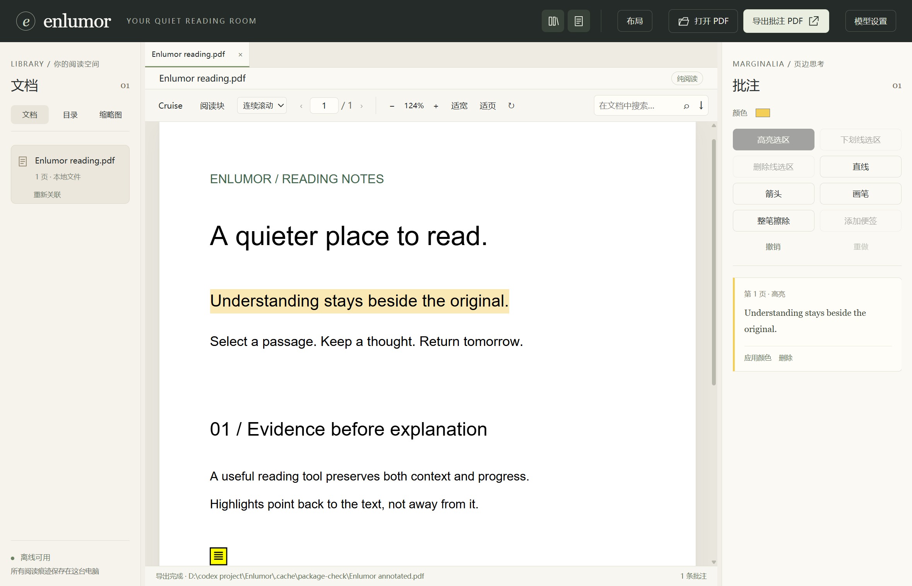

<p align="center">
  
</p>

<h1 align="center">Enlumor</h1>
<p align="center"><strong>A quieter place to read. More room to think.</strong></p>
<p align="center">A local-first academic PDF reader with annotations and optional, passage-level AI.</p>

<p align="center">
  <a href="#getting-started"></a>
  <a href="#ai-on-your-terms"></a>
  <a href="#reading-first"></a>
</p>

<p align="center">
  <a href="#a-real-reader">See the reader</a> ·
  <a href="#getting-started">Get started</a> ·
  <a href="docs/API-COMPATIBILITY.md">Provider setup</a> ·
  <a href="README.zh-CN.md">简体中文</a>
</p>

---

## Latest development snapshot — 24 October 2026

`main` now includes the latest editing integration and **Surfing whole-document co-reading** source. Surfing can use confirmed full-document text, the current page and recent in-session dialogue; full-document sending requires explicit confirmation. This differs from the legacy current-block Cruise flow described below.

This is **development code**, not a new stable binary release. Windows **0.1.15** remains the last verified release named here. See [current development status](docs/CURRENT_DEVELOPMENT.md) for capabilities, local checks and acceptance still outstanding.

## Reading first

Research does not happen in a single answer. It happens as you read a passage, mark what matters, ask a question and return to the source.

Enlumor keeps that loop close to the paper. Ordinary reading works without an account, a cloud service or an API key. AI is an optional companion—not the price of entry.

**The long-term vision:** a cognitive companion that understands and extends your thinking. Persistent thinking models and cross-document research memory are ambitions, not delivered features.

## A real reader

<p>
  
</p>

*Actual packaged Windows 0.1.15 verification capture, using an authored demo PDF. It shows reading and annotation—not a live AI result or a user study. The capture retains the interface branding used by that release.*

## What you can do

| Stay with the source | Keep your work | Ask on your terms |
| :--- | :--- | :--- |
| Search, jump, zoom and rotate. Read continuously or page by page; use document tabs and thumbnails. | Highlight, underline, strike through, add notes, arrows and ink. Undo and redo; restore local annotations and reading position. | Configure your provider and key. Cruise works around the current passage, with pause, manual control and return-to-source navigation. |

Export annotations to a **separate PDF** while preserving the original. A local SQLite workspace holds reading state; the packaged Windows app includes its PDF-processing runtime.

### AI on your terms

- **BYOK:** choose a provider, supply your own key and pay that provider directly.
- **Bounded context:** Cruise sends the current reading block, not the entire PDF. Optional AI can send this context off-device.
- **You stay in control:** pause, cancel or take over reading. Old or cancelled responses are guarded against.
- **Honest compatibility:** protocol adapters and local test coverage do not imply every provider or model has been tested with real credentials. See the [compatibility matrix](docs/API-COMPATIBILITY.md).

### Built, being tested, imagined

| State | What it means here |
| :--- | :--- |
| **Windows 0.1.15 release** | Reader, annotation and local-persistence foundation; separate annotated export; Cruise controls and provider configuration in the released code. |
| **Acceptance still needed** | Real-provider behaviour for the chosen model, and foreground reading during real AI streaming/export. A provider setting is not a successful live connection. |
| **Separate candidate work** | Later passage/source-checking changes and editing-command work must be evaluated separately. Candidate library tests are not proof of production integration. |
| **Long-term vision** | Persistent cognitive modelling, cross-document research memory and additional clients. No validated public macOS or iPad release is claimed. |

## Getting started

### Run an existing local Windows release

If you already have a verified release, extract its ZIP to a folder and launch `Enlumor.exe`. In a development checkout, `启动 Enlumor.cmd` follows the local `release/latest.json` pointer. The packaged app does not need a separate Python installation.

Release binaries are generated locally by the verified-release pipeline. This README does not imply a publicly uploaded download exists.

### Build from source

You need **Windows, Node.js 24+, Python 3.10+** and network access for initial dependency installation.

```powershell
git clone https://github.com/wolassaaa/Enlumor.git
cd Enlumor
.\setup.ps1
npm start
```

For active development:

```powershell
npm run dev
```

Restart the development command after changing the Electron main process. For packaging and release details, see the [development notes](docs/DEVELOPMENT_NOTES.zh-CN.md).

## Engineered around reading

```text
Foreground reader       React + TypeScript + PDF.js worker
        │
        ├── Local work  Electron + SQLite workspace
        ├── Export      Bundled Python / PyMuPDF → separate PDF
        └── Optional AI Bounded passage → provider adapter → guarded response
```

Responsiveness is a design requirement, not a blanket zero-lag claim. Background work still competes for CPU and memory; real streaming and export workloads need measured acceptance.

### Check the project

```powershell
npm run typecheck
npm test
npm run test:python
npm run test:e2e
```

`npm run release:verified` builds a staged package, runs its functional and performance gates, and only updates the latest-release pointer after the gates pass. Historical results describe their recorded fixtures and machines—not every PDF or device.

## Current boundaries

- No encrypted-PDF opening, OCR or whiteboard. Scanned pages can be read but do not gain text selection/search.
- Ink tools are annotation tools, not a full illustration canvas. Original PDF content is not overwritten.
- macOS has not been built and accepted; iPad requires a separate client.
- Ordinary reading is local. **Optional AI is not an offline feature.**

## Project direction & licensing

Enlumor is independently developed, with an **open-source direction** and no mandatory Enlumor subscription proposed. Solving real academic reading problems comes before forcing a paid SaaS model.

A project-wide licence has not yet been selected. Do not assume an MIT or other permissive licence. PyMuPDF has AGPL/commercial licensing conditions; project and dependency licensing must be resolved before distribution.

## Explore the work

| For readers | For builders |
| :--- | :--- |
| [中文介绍](README.zh-CN.md) · [Provider compatibility](docs/API-COMPATIBILITY.md) | [Feature delivery](docs/FEATURES.md) · [Implementation](docs/IMPLEMENTATION.md) |
| [Report a concrete reading problem](https://github.com/wolassaaa/Enlumor/issues) | [Review cadence](docs/REVIEW-CADENCE.md) · [Development notes](docs/DEVELOPMENT_NOTES.zh-CN.md) |

Feedback is most useful with a reproducible task, app version and expected behaviour. Do not post API keys or private documents in an issue.

---

<p align="center"><em>Keep the paper. Extend the thinking.</em></p>
