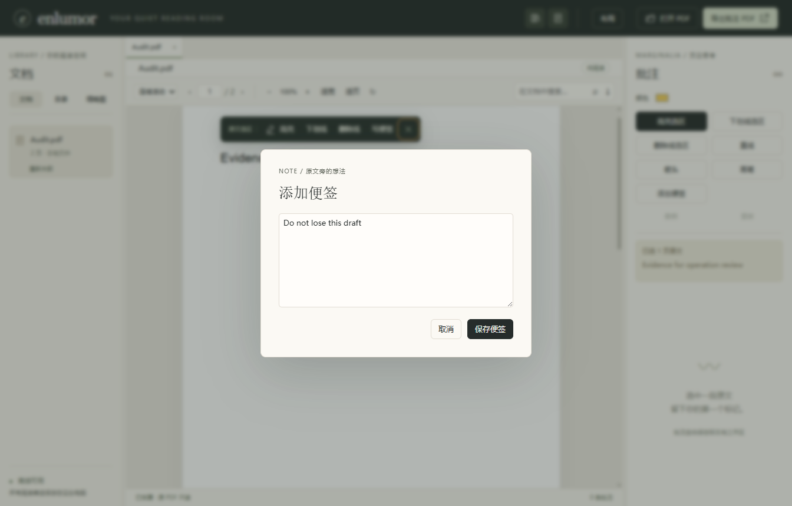
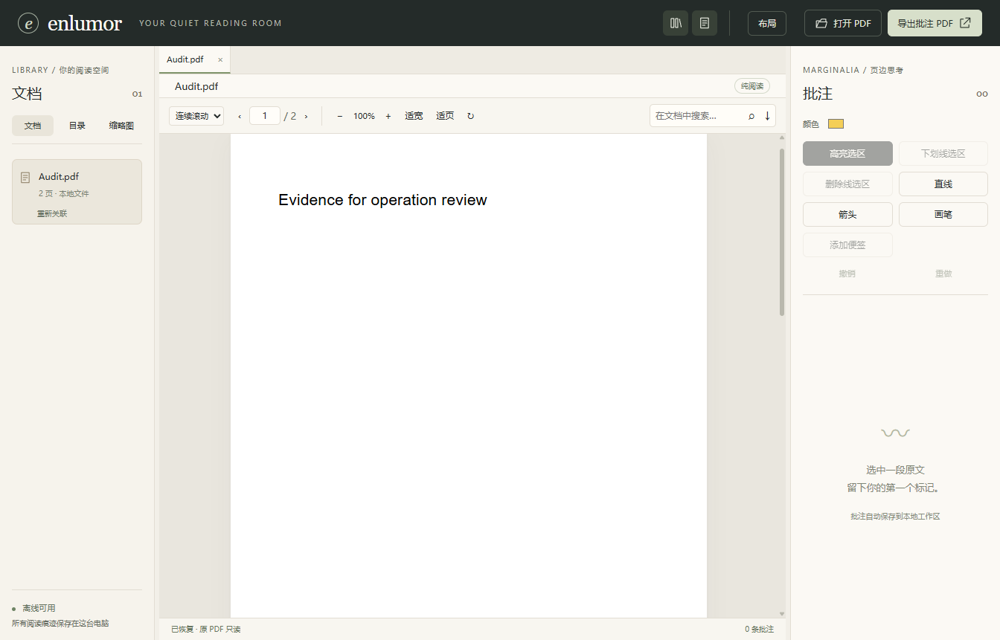
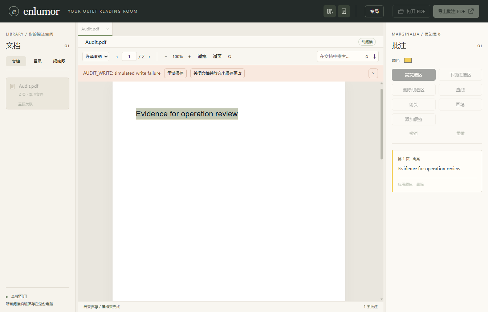
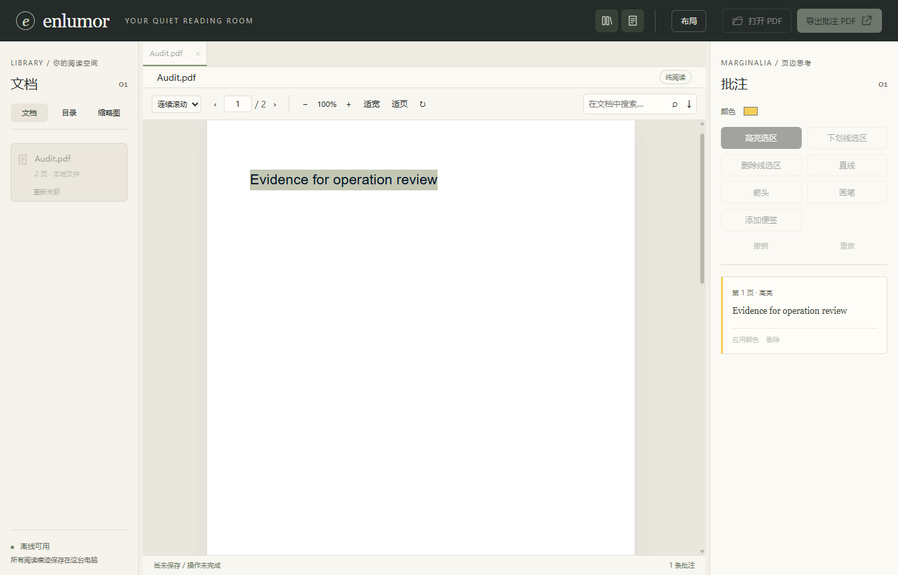

# Enlumor 操作规则专项 Review — 2026-10-16

审查版本：实际发布 EXE 0.1.8；源码基线 efdcff8；用户要求先审查操作规则，再 review。
本轮只记录问题，不修改业务代码、不更新发布包。使用全新临时工作区与合成2页PDF，失败注入仅作用审查进程。

## 先核对操作规则

| 规则 | 验收条件 | 本轮结果 |
|---|---|---|
| 工具状态明确且可退出 | 选中工具有pressed反馈；Esc取消未完成手势且不入库 | 实际取消检查通过；既有工具/布局回归另跑 |
| 模态编辑隔离背景 | Tab/Shift+Tab留在弹窗；背景控件不可操作；关闭后合理恢复焦点 | **违反，P1：焦点逃逸并导致便签草稿丢失** |
| 保存结果明确 | 数据库确认后才显示已保存；无有效锚点时不清空便签草稿 | **违反，P1：无锚点提交直接关窗而无错误** |
| 失败可恢复 | pending期间保留重试/放弃入口，关闭提示不隐藏操作入口 | **违反，P2：关闭提示后重试入口消失** |
| 标签/事务隔离 | 待保存或便签草稿期间不切换/关闭标签；每标签历史独立 | 当前pending Ctrl+W保护有效；既有标签回归另跑 |
| 布局改变取消绘制 | 侧栏/间距/旋转改变前同步取消旧几何手势 | 本轮运行既有箭头/画笔回归，不仅查看旧日志 |
| 边界控件反馈真实 | 首页上一页、末页下一页禁用；无效页码给反馈 | **建议，P3：首页上一页仍可点击但无动作** |
| 原PDF与个人数据保留 | 审查不更改原文件或个人工作区，不把临时状态记成永久批注 | 使用独立profile；此次故障为合成注入 |

模态规则参照 [W3C APG Modal Dialog](https://www.w3.org/WAI/ARIA/apg/patterns/dialog-modal/)：
背景应不可交互，Tab循环限制在弹窗中；应提供dialog语义、名称与aria-modal；关闭后恢复合理焦点。
恢复规则沿用原计划“保存失败保留待保存操作和重试入口”，不把关闭错误提示等同于放弃待保存操作。

## Code review

Found 2 urgent issues need to be fixed:

### 1 [P1] 便签弹窗焦点逃逸，背景操作后“保存”静默丢弃草稿
FilePath: D:/codex project/Enlumor/src/renderer/main.tsx line 255
相关分支：85–92只有Ctrl+Tab/Ctrl+W保护；254背景取消选区；191–192 add在parts为空时直接返回；255随后无条件setNote(null)。

复现：
1. 选原文，点“添加便签”，输入 Do not lose this draft。
2. Shift+Tab：焦点从textarea移到背景浮栏“取消选区”，不是弹窗内保存按钮。
3. Enter取消背景选区，弹窗与文字仍在。
4. 点“保存便签”：弹窗关闭，数据库批注0条，错误提示0，状态仍“已恢复 · 原 PDF 只读”。

Literal evidence:
NOTE_FOCUS_ESCAPE: {"tag":"BUTTON","label":"取消选区","text":"","inside":false}
NOTE_SAVE_AFTER_BACKGROUND_CANCEL: {"modalCount":0,"stored":0,"status":"已恢复 · 原 PDF 只读","alerts":0}

### Suggested fix
模态实现焦点循环与背景inert，增加dialog/aria-modal/可访问名称，关闭后恢复触发点。
提交前验证文档与锚点；没有有效锚点应保留草稿并说明原因，而非关闭弹窗。
原文锚点宜随创建便签时固定；仅靠焦点陷阱不足以替代提交校验。
补充真实键盘Shift+Tab/Tab、背景操作隔离、无锚点提交与保存失败草稿回归。

---

### 2 [P2] 关闭保存错误提示同时移除唯一重试入口，操作仍保持锁定
FilePath: D:/codex project/Enlumor/src/renderer/main.tsx line 238
相关分支：151–166 commit失败保留pending；238错误栏整体以error非空为条件显示，关闭按钮仅setError('')；各编辑/导出按钮按pending禁用。

复现：
1. 已有高亮，注入一次annotation:change写入失败。
2. 点删除，显示错误、重试与放弃入口；原高亮仍保留（正确）。
3. 点关闭错误提示：错误栏和重试/放弃入口全部消失，导出与绘图保持禁用。
4. Ctrl+W仍不关闭当前标签；没有直接可见的恢复按钮。
5. 跳到第2页触发阅读位置flush后，UNSAVED_CHANGE重新显示错误栏，重试才能完成原删除。

Literal evidence:
DISMISS_SAVE_ERROR: {"retryButtons":0,"alerts":0,"exportDisabled":true,"drawDisabled":true,"status":"尚未保存 / 操作未完成","stored":1}
PENDING_CLOSE_SHORTCUT: {"tabs":1,"retryButtons":0}
RECOVERY_AFTER_READING_FLUSH: {"stored":0,"status":"已保存 · 本地 SQLite"}

这是恢复入口隐藏，不是数据库已丢失，也不是永久死锁；依赖翻页等无关操作重新暴露错误是不合理的恢复路径。
初次审查尝试关闭窗口不会重新展示错误栏；pending导致正常关闭保持打开。审查进程随后结束，最终复现改用阅读flush恢复，日志保留INITIAL.log。

### Suggested fix
pending恢复区域独立于可关闭的错误消息；始终展示“未保存变更”、重试与明确放弃。
关闭错误详情只收起说明，不隐藏恢复操作、不清除pending。
补充“注入失败→关闭详情→仍有重试→成功提交”的端到端测试。

---

Found 1 suggestions for improvement:

### 1 [P3] 首页“上一页”仍可点击但无动作
FilePath: D:/codex project/Enlumor/src/renderer/main.tsx line 234
PDF reader的go函数拒绝超界页码；但上一页/下一页仅按“是否存在文档”禁用，视觉反馈与实际可执行状态不一致。
Literal evidence: PAGE_BOUNDARY: {"page":"1","previousEnabled":true}

### Suggested fix
分别按当前页与总页数禁用边界按钮；无效页码提交提供可读反馈并恢复当前页值。

## 已确认正常
- Esc绘制取消：drafts=0，stored=0，pressed=false。
- 写入失败时原批注没有被乐观删除；pending阻止Ctrl+W切换/关闭。
- 阅读flush重新呈现错误后，重试完成的是原待处理删除，保存状态为“已保存 · 本地 SQLite”。
- 既有侧栏、标签、箭头/画笔操作回归33项通过（50.7s，退出0），见本轮REGRESSION.log；通过旧用例不代表覆盖本轮新发现的操作序列。

## 本轮命令与证据
- 审查脚本：node .cache/audit-operations.mjs
- 最终脚本退出码0，7个操作观察记录见 results.json / RUNTIME.log。退出0表示审查成功复现与记录，不表示产品没有缺陷。
- 可复用脚本归档 evidence/operation-review-2026-10-16/reproduce.mjs：
  node evidence/operation-review-2026-10-16/reproduce.mjs（在项目根目录执行；只用独立profile）。
- 既有回归：
  $env:ENLUMOR_TEST_APP=(Resolve-Path release/Enlumor-0.1.8-win-x64/Enlumor.exe).Path
  $env:ENLUMOR_EVIDENCE_DIR='evidence/operation-review-2026-10-16'
  npx playwright test workspace.spec.ts arrows-ink.spec.ts
- 源码、发布EXE及latest.json保持0.1.8；本轮没有修复发布。
- 四张报告截图为本次运行捕获并实际查看；状态/落库数量同时由DOM和preload查询确认，不只凭截图判断。
- 未重跑200页性能门禁、屏幕阅读器或独立Acrobat。错误注入不代表本机磁盘实际故障。
- 本机frontend-code-review skill的references目录缺失；本轮依据项目既定规则、实际源码、真实Electron复现与W3C模态交互规范审查，不声称完成缺失清单。

## 后续修复顺序
先修P1便签草稿与P2失败恢复，再推进擦除。此用户主动专项审查不算新增两项功能，功能Review计数仍0。

可复用执行提示：
> 按本报告两条Important逐项先写能复现的失败测试，再实现模态背景隔离/提交保护与pending恢复入口；保留用户数据，跑完整release:verified通过后发布，再继续擦除。

## 修复追记 — 0.1.9（2026-10-16）
用户批准修复后，P1/P2已按上述建议实现并通过失败→成功测试。原文保留0.1.8审查事实，不把历史问题抹除。
新增note-recovery.spec.ts五条测试：焦点隔离/恢复、原文锚点固定、失败草稿重试与Esc保护、关闭错误后恢复入口常驻、放弃失败编辑保留旧便签。
完整发布102项通过，发布EXE五项再测通过；证据见../../evidence/note-recovery/VERIFICATION.txt。
P3边界反馈仍暂缓，未纳入本次修复。
